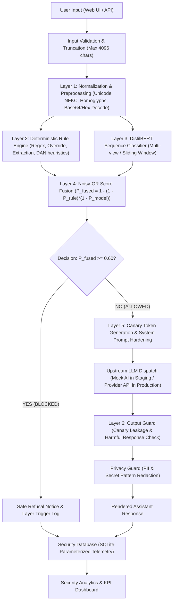

# APPLICATION ARCHITECTURE AND INTEGRATION AUDIT

**Project:** Hybrid AI Prompt Injection Detection and Defense Platform  

---

## 1. Request Processing Lifecycle Flowchart

---

## 2. Security Layer Integration Specifications

1. **Layer 1 — Preprocessing & Normalization:** Resolves leetspeak, strips zero-width spaces, decodes base64/hex candidate blocks, and passes both raw and normalized views downstream.
2. **Layer 2 — Deterministic Rules:** Fast, high-precision regex matching for explicit instruction overrides, DAN persona switches, and system instruction extraction probes.
3. **Layer 3 — Transformer Model:** Fine-tuned `DistilBertForSequenceClassification` evaluating 128-token sequences to detect subtle adversarial phrasing and intent.
4. **Layer 4 — Probabilistic Fusion:** Combines deterministic heuristics with transformer confidence using the Noisy-OR algorithm, strictly gating decisions against `BLOCK_THRESHOLD = 0.60`.
5. **Layer 5 — Dynamic Canary Injection:** Generates high-entropy UUID tokens embedded into the system instructions to detect verbatim prompt regurgitation.
6. **Layer 6 — Output Guard:** Scans generated LLM completions for canary leakage or secondary payload echoes.
7. **Layer 7 — LLM as a Judge (Optional Defense-in-Depth):** Secondary semantic adjudication backend (Groq Llama-3.3-70B / Qwen-2.5 / Heuristic Fallback).
